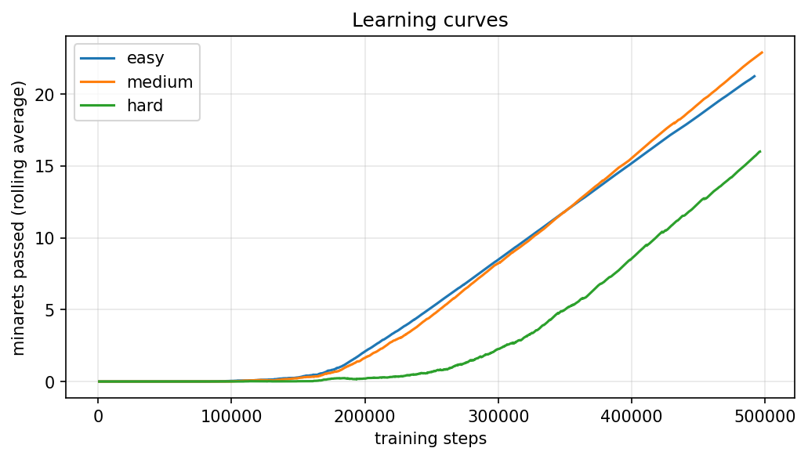
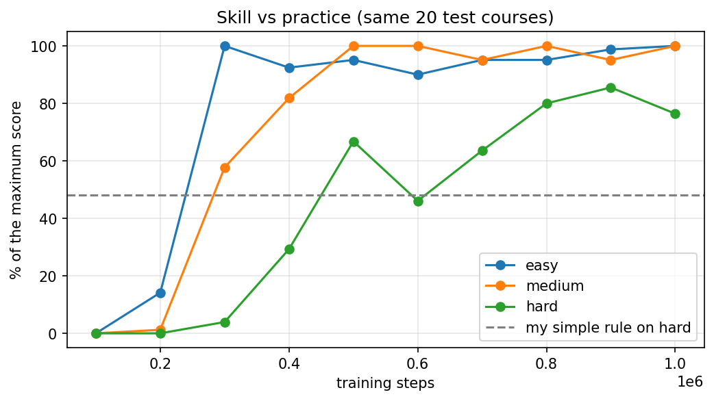

# Stork Flight: an AI learns to fly over Morocco

**[▶ Play it in your browser](https://ryeggouti.github.io/stork-flight/)** · [Open the notebook in Colab](https://colab.research.google.com/github/ryeggouti/stork-flight/blob/main/stork_flight.ipynb)

**Part 2 of my reinforcement learning project.** In [Part 1](https://github.com/ryeggouti/lunar-lander-rl) I used a ready-made environment (Lunar Lander). Here I built my own: a white stork flying between minarets and storm clouds over a Moroccan city. Then I trained an AI to play it, tested what it learned, and put the trained AIs into a game you can race against.

White storks really do nest on minarets in Morocco, which is where the idea came from.

## The game

- **Solo:** fly between the minarets and the storm clouds. Medals at 10, 20, 30 and 40 minarets unlock new storks.
- **Race the AI:** a see-through stork flies the same course next to you. Pick your opponent: Beginner, Intermediate, Experienced or Seasoned. Each one is a real snapshot from training, not an AI made worse on purpose.
- **Watch the AI:** the AI flies on its own.
- **Lab view** (press `L`): shows the 5 numbers the AI sees, the gap it's aiming for, where it flapped, the reward it's trying to maximise and the real hitboxes.

The game runs the same rules as the training environment, step for step (30 steps per second, the same gravity and gaps), so a human score and an AI score mean the same thing. All drawings and sounds are made with code; there are no image or audio files.

## The environment

`stork_env.py` is a [Gymnasium](https://gymnasium.farama.org/) environment I wrote.

- **Actions:** glide or flap.
- **What the AI sees:** only 5 numbers: its height, its vertical speed, the distance to the next gap, how far the gap's centre is above or below it, and the gap size.
- **Rewards:** +0.1 for every step alive, +1 for each minaret passed, −1 for a crash.
- **Levels:** Easy, Medium and Hard. Harder levels have narrower gaps (180 → 130 pixels) and move faster.
- A run stops after 100 seconds, so the most minarets possible are 41 on Easy, 49 on Medium and 56 on Hard.

The AI is trained with PPO from [Stable-Baselines3](https://stable-baselines3.readthedocs.io/). Every pilot is tested on the same 20 courses, which it never saw during training.

## Results

### 1. Baselines: what does "good" look like?

| Pilot | Easy | Medium | Hard |
|---|---|---|---|
| Random flapping | 0.0 | 0.0 | 0.1 |
| My one-line rule (*flap when below the gap's centre and falling*) | 41.0 | 43.0 | 26.9 |

My one-line rule is already perfect on Easy, so the real test is on Medium and Hard.

### 2. The AI after 500k steps of practice

| Pilot | Easy | Medium | Hard |
|---|---|---|---|
| My one-line rule | 41.0 | 43.0 | 26.9 |
| AI (PPO) | 37.6 | **49.0** | 19.9 |

Before training, I predicted the AI would beat my rule everywhere and score about 45 on Hard. It only won on Medium, where it was perfect.

All three learning curves were still rising when training stopped, and Hard started improving noticeably later than the others.

### 3. Does it generalise?

Each AI tested on every level (average minarets passed):

| Trained on ↓ / tested on → | Easy | Medium | Hard |
|---|---|---|---|
| Easy | 37.6 | 13.1 | 1.4 |
| Medium | **41.0** | 49.0 | 11.3 |
| Hard | 36.9 | 44.1 | 19.9 |

- **Skills transferred downwards, not upwards.** AIs trained on harder levels could fly easier ones, but the Easy AI collapsed on Hard (1.4, almost as bad as random). I had predicted it would only do "a bit worse".
- **The best Easy pilot never trained on Easy.** The Medium-trained AI was perfect on Easy (41.0), better than the Easy-trained AI (37.6).

### 4. More practice: training for 1 million steps

The learning curves were still rising at 500k steps, so I trained each level again for 1 million steps and tested a snapshot every 100k.

| Training steps | Easy | Medium | Hard |
|---|---|---|---|
| 100k | 0.0 | 0.0 | 0.0 |
| 200k | 5.8 | 0.6 | 0.0 |
| 300k | 41.0 | 28.3 | 2.2 |
| 400k | 37.9 | 40.1 | 16.4 |
| 500k | 39.0 | 49.0 | 37.4 |
| 600k | 36.9 | 49.0 | 25.8 |
| 700k | 39.0 | 46.6 | 35.6 |
| 800k | 39.0 | 49.0 | 44.8 |
| 900k | 40.5 | 46.6 | **47.9** |
| 1M | 41.0 | 49.0 | 42.8 |

- **With more practice, the Hard AI beat my rule** (26.9), peaking at 47.9.
- **One training run can be misleading.** At 500k steps this run scored 37.4 on Hard; my first run scored 19.9 at exactly the same point with the same settings. Part of my "the Hard AI is weak" conclusion from section 2 was the luck of that one run.
- **More practice isn't always better.** Easy was perfect at 300k, dipped, and came back at 1M. Hard dropped from 47.9 to 42.8 at the end.

### 5. The opponents in the game

For each level I picked four snapshots by skill: Beginner (about 25% of the maximum score), Intermediate (about 55%), Experienced (about 85%) and Seasoned (the best snapshot). For Easy and Medium, which jump from almost 0% to almost 100% between 200k and 300k steps, I saved extra snapshots every 20k steps to find the in-between AIs.

| Opponent | Easy | Medium | Hard |
|---|---|---|---|
| Beginner | 13.8 | 11.1 | 16.4 |
| Intermediate | 20.6 | 28.3 | 35.6 |
| Experienced | 36.9 | 40.1 | 44.8 |
| Seasoned | 41.0 | 49.0 | 47.9 |

The networks are exported from Python to `networks.js` and run directly in the browser. I checked that the browser versions make exactly the same decisions as the Python models.

### 6. Part 3: turning it into an app

I took the game further as a separate project: an Android app and an
online 1v1 mode, in [stork-flight-app](https://github.com/ryeggouti/stork-flight-app)
([play it](https://ryeggouti.github.io/stork-flight-app/)).

- **Android app:** the game files are packed into a real APK (built with
  Capacitor by a GitHub Actions workflow), fullscreen, with haptics.
- **1v1 online:** two devices connect directly to each other with a 4-letter
  room code. Both build the same course from one shared seed, so only the
  storks' heights travel over the network.
- **Testing on real devices:** I tested it on my phone, my mom's Samsung and a
  computer, and over a VPN. That's how I found bugs like oversized buttons from
  the phone's font setting and being able to change the level mid-match.

I designed the features and tested everything myself; an AI coding assistant
wrote most of the code for this part.

## Limits

- 20 test courses per AI is a small sample.
- Most results come from a single training run per level, and section 4 shows how much one run can vary. Repeating training with several seeds, as I did in Part 1, would make the conclusions stronger.

## Files

| File | What it is |
|---|---|
| `index.html`, `styles.css`, `game.js` | the game |
| `networks.js` | the 12 trained AI opponents |
| `stork_env.py` | the Gymnasium environment |
| `stork_flight.ipynb` | my notebook: baselines, predictions, training, results and the export to the game |
| `results/` | results tables and graphs |

## Run it yourself

- **Play:** open `index.html` in a browser, or use the link at the top.
- **Train:** open the notebook in Colab and run the cells in order. It writes `stork_env.py` for you.

---

I wrote this project with help from an AI coding assistant. The questions, the predictions and the conclusions are mine.
